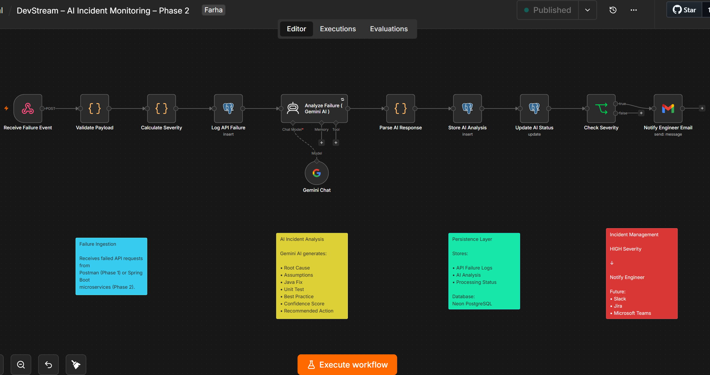

# DevStream


> DevStream is an AI-powered backend incident monitoring platform that automates API failure analysis using workflow orchestration, Google Gemini for AI-assisted analysis, and PostgreSQL for persistent monitoring.

---

## Overview

DevStream is an AI-powered backend incident monitoring platform designed to automate the analysis of failed API requests.

The platform integrates a Spring Boot backend with an n8n workflow to capture API failures, validate incoming requests, generate AI-assisted analysis using Google Gemini, store monitoring data in PostgreSQL, and send email notifications based on incident severity.

By combining backend engineering, workflow automation, artificial intelligence, and persistent data storage, DevStream transforms a traditionally manual debugging process into a structured, repeatable, and scalable monitoring solution.

---

## DevStream by Phase

| Phase | What I built | Explore |
|---|---|---|
| **Phase 1 — AI Monitoring** | Built an n8n workflow that validates API failure reports, analyzes them with Gemini, stores results in PostgreSQL, and sends severity-based email alerts. | [Phase 1 workflow](workflow/DevStream_AI_Incident_Monitoring.json) |
| **Phase 2 — Spring Boot Integration** | Added a Java and Spring Boot REST API that receives failure reports and forwards them to the existing n8n workflow. Documented the architecture, API, database, and workflow. | [Phase 2 engineering docs](docs/phase2/README.md) · [Phase 2 workflow](workflow/DevStream_AI_Incident_Monitoring_Phase2.json) |
| **Phase 3 — AI Incident Management** | Added fingerprint-based incident grouping, lifecycle and assignment tracking, AI orchestration and retries, reusable incident knowledge, Smart Notifications, and seven Grafana dashboards. | [Phase 3 engineering docs](docs/phase3/README.md) · [Release verification](docs/phase3/release-verification.md) |

**Phase 3 regression:** `/test-error` produced failure `100`, which linked to incident `7` and reached AI status `COMPLETED`. Notification history entry `51` recorded duplicate suppression for incident `7`.

---

## Business Problem

Modern applications rely on APIs to connect services, exchange data, and power business operations. When an API request fails, engineers often need to manually inspect logs, request payloads, error messages, and system responses before identifying the root cause.

This investigation process is repetitive, time-consuming, and difficult to scale, especially when similar failures occur across multiple services. As applications grow, manual analysis increases operational effort and delays incident resolution.

Engineering teams need an automated approach that captures failure information, performs consistent AI-assisted analysis, stores investigation results, and delivers actionable insights without disrupting existing development workflows.

---

## Solution

DevStream automates the end-to-end API failure analysis workflow by integrating backend services, workflow automation, artificial intelligence, and persistent data storage into a unified monitoring pipeline.

When a failed API request is received, the platform:

1. Receives the failure request from the Spring Boot application.
2. Validates and processes the incoming payload.
3. Records the failure details in PostgreSQL.
4. Invokes Google Gemini to generate AI-assisted analysis.
5. Updates the monitoring repository with AI-generated insights.
6. Sends email notifications based on the severity of the incident.

This automated workflow minimizes repetitive investigation tasks, standardizes incident analysis, and enables engineering teams to respond to failures more efficiently.

---

## Engineering Highlights

- Built with Java 21 and Spring Boot 3
- RESTful backend integration
- PostgreSQL persistence layer
- Workflow orchestration using n8n
- AI-assisted analysis using Google Gemini
- Automated email notifications
- Modular architecture for future enhancements

## Phase 2 System Workflow

DevStream processes API failures through an automated workflow that combines backend services, workflow orchestration, artificial intelligence, and persistent storage.

The Spring Boot application receives failed API requests and forwards them to an n8n workflow. The workflow validates the payload, determines the incident severity, records failure details in PostgreSQL, invokes Google Gemini to generate AI-assisted analysis, updates the monitoring records with the generated insights, and sends email notifications for high-severity incidents.

This workflow provides a consistent, repeatable process for incident analysis while keeping the backend and workflow orchestration loosely coupled.

### Workflow Diagram



For incident grouping, AI retries, and Smart Notifications, see the [Phase 3 implementation overview](docs/phase3/overview.md).

## Technology Stack

| Layer | Technology |
|-------|------------|
| Programming Language | Java 21 |
| Backend Framework | Spring Boot 3 |
| Workflow Automation | n8n |
| AI Service | Google Gemini |
| Database | PostgreSQL |
| Email Notifications | Gmail |
| API Testing | Postman |
| Version Control | Git & GitHub |
| IDE | IntelliJ IDEA |

## Database Overview

DevStream uses PostgreSQL as its primary persistence layer to store API failure events, AI-generated analysis, and notification records. The database provides a structured repository for monitoring data, enabling traceability, historical analysis, and reporting and analytics.

The complete database schema, ER diagram, table definitions, relationships, and SQL scripts are available in:

📄 **docs/phase2/database.md**

---

## Documentation

Comprehensive technical documentation is available for every major component of DevStream.

| Document | Description |
|----------|-------------|
| `docs/phase2/README.md` | Engineering Design Document for Release 2 |
| `docs/phase2/architecture.md` | System architecture and component interactions |
| `docs/phase2/api.md` | REST API endpoints, request/response models, and integration details |
| `docs/phase2/database.md` | Database schema, relationships, and SQL scripts |
| `docs/phase2/workflow.md` | End-to-end workflow execution and node-level explanation |
| [Phase 3 database reference](docs/phase3/database.md) | Monitoring tables, constraints, and verification SQL |
| [Phase 3 Grafana dashboards](docs/phase3/dashboards.md) | Seven dashboards and 59 panel queries |
| [Phase 3 release verification](docs/phase3/release-verification.md) | End-to-end regression and database cleanup evidence |

---

## Repository Structure

```text
DevStream/
├── database/
│   └── phase3/
├── docs/
│   ├── phase2/
│   └── phase3/
├── images/
├── workflow/
│   ├── DevStream_AI_Incident_Monitoring.json
│   └── DevStream_AI_Incident_Monitoring_Phase2.json
├── CHANGELOG.md
├── LICENSE
└── README.md
```

---

## Project Status

**Phase 3 implementation and final end-to-end regression are complete.** Release preparation is in progress. The demo, presentation, and portfolio and staging deployment are still ahead.

## Roadmap

### ✅ Release 1 – AI Monitoring
- n8n workflow automation
- AI-powered API failure analysis
- PostgreSQL persistence
- Email notifications

### ✅ Release 2 – Spring Boot Integration
- Spring Boot REST API integration
- End-to-end backend workflow
- Improved documentation
- Modular project structure

### ✅ Release 3 – AI Incident Management (Implementation Complete)
- Incident fingerprinting
- Incident deduplication
- Knowledge Base
- Enhanced AI analysis
- Smarter notifications
- Grafana dashboards

---

## License

This project is licensed under the MIT License.

See the **LICENSE** file for details.

## Author

**Farha Serin Naaz**

Backend Engineering | Java | Spring Boot | Workflow Automation | Generative AI

DevStream showcases my approach to building production-oriented backend systems by combining Java, Spring Boot, workflow automation, AI-assisted analysis, and PostgreSQL into a practical engineering solution.
